### Goroutine
- Goroutine 是 Go 实现Concurrency(并发)的核心机制. 它类似于Lightweight Thread, 允许多个任务并发执行，而不需要开发者直接管理operating system threads. Goroutine 并不等于 OS Thread。 大量 Goroutine 可以复用少量 OS Threads
- 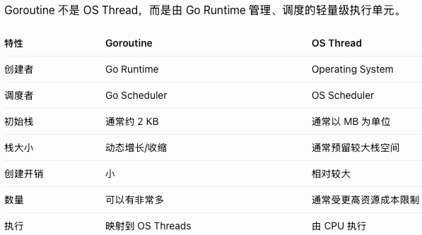  
- **Concurrency vs Parallelism**
	- Concurrency（并发）：多个任务在同一段时间内取得进展，不一定同时执行
	- Parallelism（并行）：多个任务在同一时刻真正同时执行，需要多个 CPU 执行资源
	- Go 同时支持 Concurrency 和 Parallelism
 	- 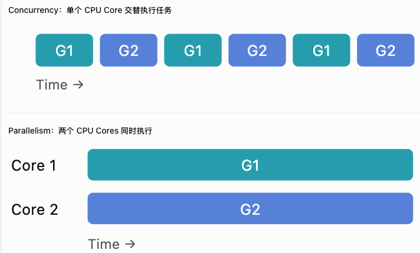 
- **如何创建 Goroutine?**
	- 方式一：使用 `go` 调用普通函数
		- ```go
		  func worker(){
			  fmt.Println("worker is running")
		  }
		  func main(){
			  go worker() //创建goroutine
			  // main() 不会等待 `worker()` 执行完成
			  //当 `main()` 返回时，整个 Go 程序就会退出，即使其他 Goroutine 还没执行完
		  }
		  ```
	- 方式二：使用匿名函数
		- ```go
		  func main(){
			  go func(){
				  fmt.Println("Hello from goroutine")
			  }()
		  }
		  ```
- **Goroutine 是如何执行的？**
	- Go 使用 GMP Scheduling Model 管理 Goroutine
 	- 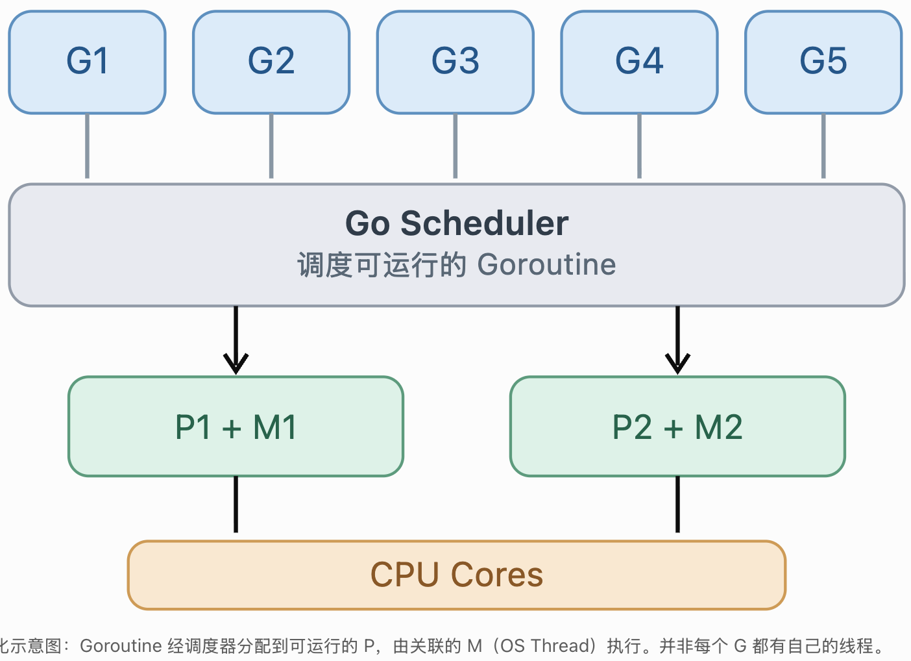  
	- 核心流程:
		- 1. 执行 `go worker()`，Go Runtime 创建 Goroutine
		- 2. 新的 Goroutine 进入可运行状态，并被放入运行队列
		- 3. Go Scheduler 选择一个 Goroutine
		- 4. 持有 P(Processor) 的 M(Machine) 执行该 Goroutine
		- 5. 当 Goroutine 阻塞、被抢占或完成时，调度器可以安排其他 Goroutine 执行
- **如何等待 Goroutine 执行完成？**
	- 通常使用 `sync.WaitGroup`, 如果只有一个 Goroutine，也可以直接使用 Channel
	- ```go
	  func worker(id int, wg *sync.WaitGroup){
		  defer wg.Done() //当前 Goroutine 完成计数减一,可以保证正常返回时通知 WaitGroup 任务已完成
		  fmt.Println("Worker:", id)
	  }
	  func main(){
		  var wg sync.WaitGroup
		  for i:=0; i<5; i++ {
			  wg.Add(1) // 增加一个待完成的任务
			  go worker(i, &wg)
		  }
		  wg.Wait() // 阻塞当前 Goroutine，直到计数归零
		  fmt.Println("All workers finished")
	  }
	  ```
- **Goroutine 如何与 Channel 配合?**
	- Go 很重要的设计理念是：`Do not communicate by sharing memory; instead, share memory by communicating`. Goroutine 负责执行并发任务，Channel 负责 Goroutine 之间的通信和同步
	- ```go
	  func worker（ch chan int）{
		  ch <- 30 // 将30发送给channel
	  }
	  func main() {
		  ch := make(chan int) //创建channel
		  go worker(ch) // 创建并执行goroutine，同时将channel传给goroutine
		  result := <-ch // ch发送数据给result
		  fmt.Println(result) // 30
	  }
	  ```
	- 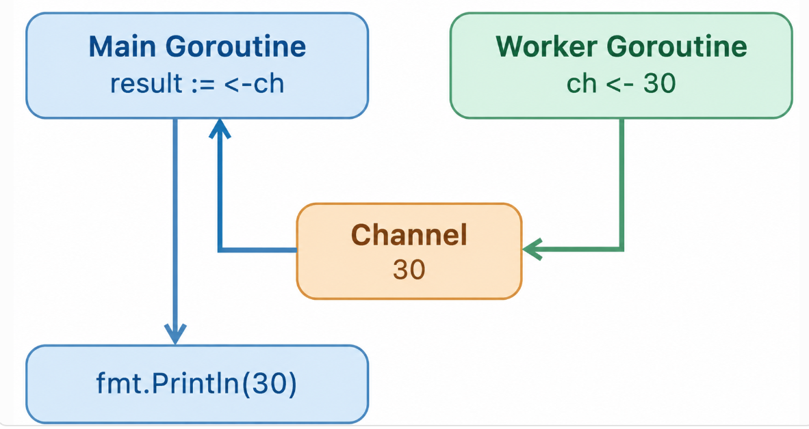  
- **实际工程中如何使用 Goroutine：Worker Pool**
	- 无论有多少jobs，都只使用固定数量的 Worker 并发处理, 多个 Worker 共享同一个 Jobs Channel. Worker 通过竞争接收 Channel 中的数据来获取任务. Go Runtime 和 Channel 的同步机制会帮助完成job分发. 对于每个发送到 Channel 的 Job，只有一个 Worker 会接收到它。Note： 哪个 Worker 接到哪个 Job 并没有固定顺序
	- 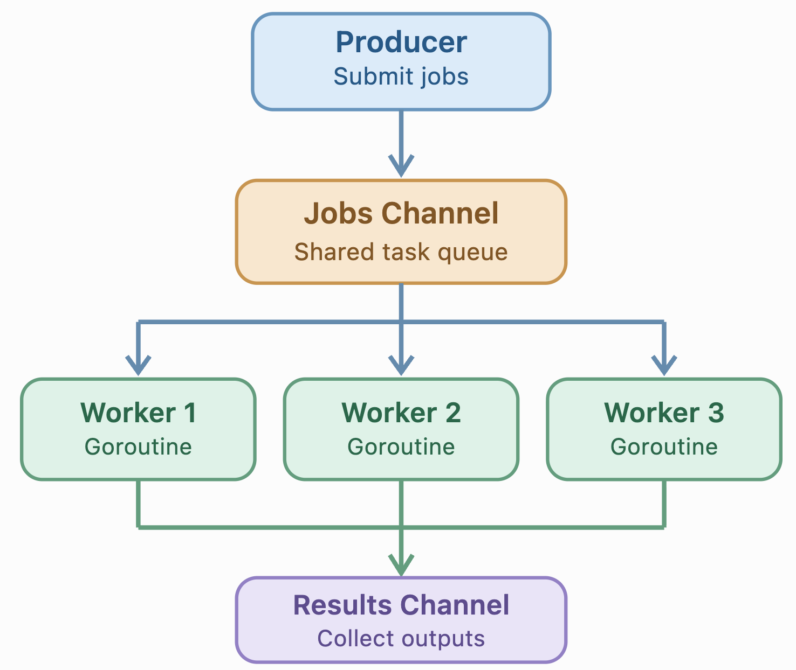  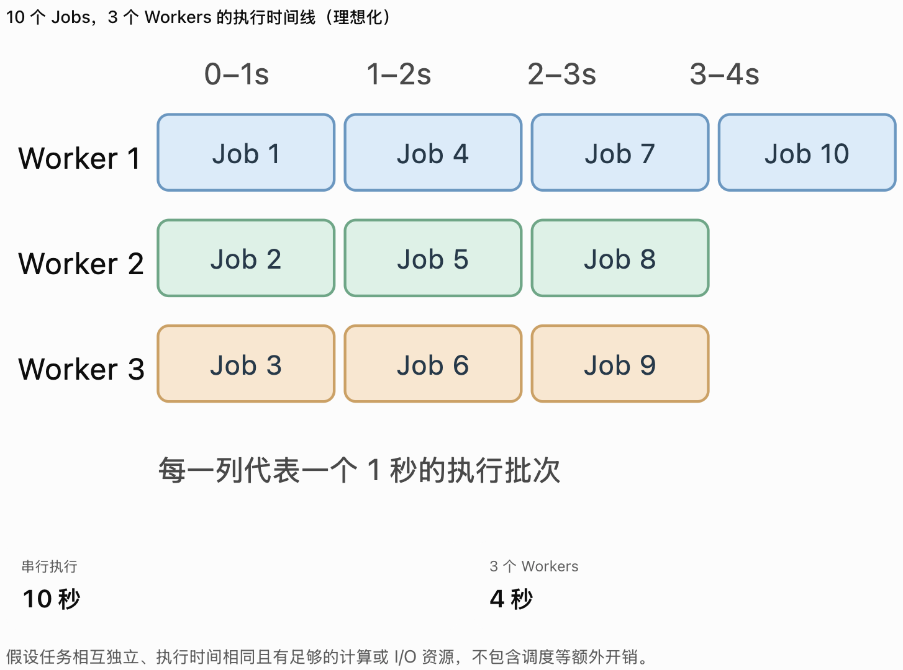  
	- ```go
	  // worker pool简易版本的代码
	  func worker(id int, jobs <-chan int, results chan<- int, wg *sync.WaitGroup) {
		  defer wg.Done()
		  //这是worker pool最核心的代码
		  //Worker从jobs Channel取任务,如果没有数据，但Channel没关闭Worker阻塞等待
		  //一旦有 Job，Worker获取它并执行, 完成后再次尝试获取 Job
		  //当jobs Channel 被关闭且所有剩余任务都被接收完毕后，退出循环 
		  for job := range jobs {
			  fmt.Printf("Worker %d processing job %d\n", id, job)
			  time.Sleep(500*time.Millisecond) // Simulate work
			  results <- job*2 
		  }
		  fmt.Printf("Worker %d finished\n", id)
	  }
	  func main(){
		  const numWorkers = 3
		  const numJobs = 10
		  jobs := make(chan int, numJobs) // Producer 向它发送任务，Worker 从它读取任务
		  results := make(chan int, numJobs) // Worker 向它发送结果，Main Goroutine 从它读取结果
		  // 在实际项目中，不建议总是让 Channel 容量等于任务总数，因为可能会有数百万个任务。
		  
		  var wg sync.WaitGroup
		  //Step 1: Start workers
		  for i:=1; i<=numWorkers; i++ {
			  wg.Add(1)
			  go worker(i, jobs, results, &wg) // 创建3个worker goroutines，代表worker pool
		  }
		  
		  //Step 2: Submit jobs
		  for j:=1; j<=numJobs; j++ {
			  jobs <- j
		  }
		  
		  //Step 3: Signal no more jobs
		  close(jobs)// 关闭 Channel 并不意味着立刻终止 Workers，如果 Buffered Channel里还有未处理的任务，Worker 仍然可以继续接收剩余的任务 
		  
		  //Step 4: Close results after all workers finish
		  go func() {
			  wg.Wait()
			  close(results)
		  }()
		  
		  //Step 5: Collect results
		  for results:= range results {
			  fmt.Println("Result:", result) // 输出顺序可能不同，因为 Workers 是并发执行的
		  }
		  fmt.Println("All jobs completed")
	  }
	  ```

### Channel
- Channel（通道）Channel 可以理解为 Goroutine 之间传递数据的管道。  它允许不同的 Goroutine 之间安全地传递数据，并且可以用来进行同步（Synchronization）,是 Go 并发编程（Concurrency）中最重要的机制之一
	- 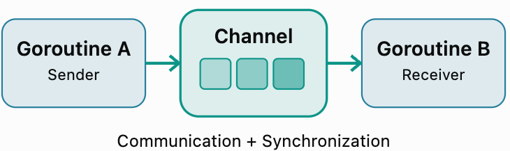  
	- ```go
	  //Channel 不仅能传递数据，还能让 Goroutine 等待彼此
	  ch := make(chan int)
	  go func() {
		  ch <- 10 // Send data
	  }()
	  value := <-ch // Receive data
	  fmt.Println(value) // 10
	  ```
- **Channel 的基本操作**
	- 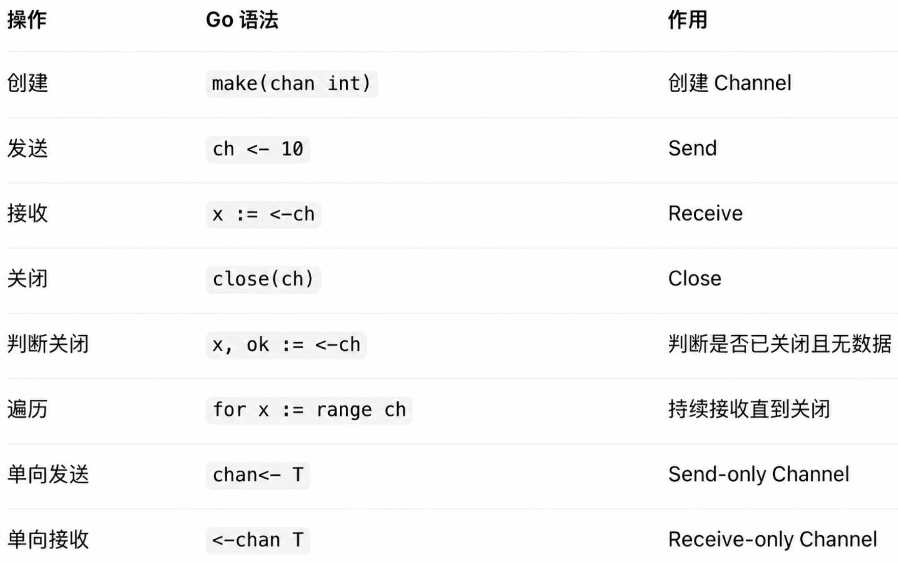  
- **Buffered vs. Unbuffered Channel**
	- buffered channel有缓冲空间，unbuffered channel没有
	- Channel 的缓冲区遵循 FIFO（First In, First Out）
	- 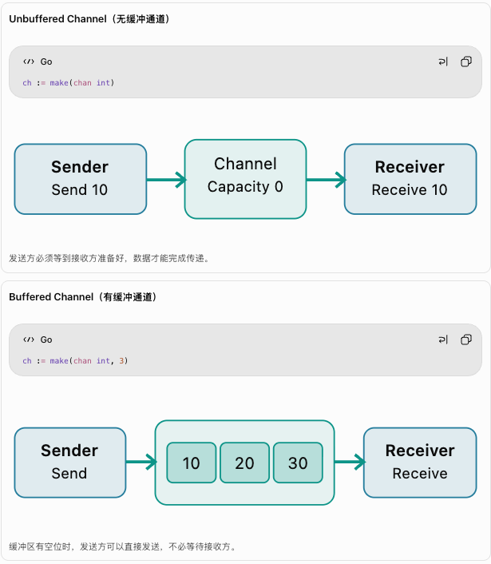  
- **Channel 的 Blocking Behavior**
	- Go Channel 默认的 Send 和 Receive 都可能 Blocking。
	- 这里所谓的 Blocking，是指 当前 Goroutine 被挂起，而不是整个 OS Thread 必然被阻塞.Go Runtime Scheduler 可以继续调度其他 Goroutine
	- 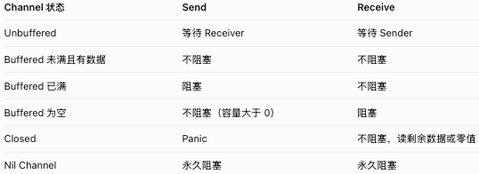  
- **如何关闭 Channel？**
	- ```go
	  ch := make(chan int, 2)
	  ch <- 10
	  ch <- 20
	  close(ch)
	  fmt.Println(<-ch) // 10
	  fmt.Println(<-ch) // 20
	  fmt.Println(<-ch) // 0
	  value, ok = := <-ch
	  // ok==true: 成功接收到发送的数据
	  // ok==false: channel已关闭，并且里面没有剩余数据
	  ```
	- 通常由发送方负责关闭 Channel，用来通知接收方不再有新的数据
	- 注意：关闭 Channel 不等于删除 Channel，也不等于立即清空 Buffered Channel
- **context.Context 使用 Channel**
	- `ctx.Done()` 返回的是一个 `<-chan struct{}` 类型的 Receive-only Channel. 当 Context 被取消或者 Deadline 到期时，这个 Channel 会被关闭
	- 实际上没有向 Channel 发送任何数据, 它利用的是关闭 Channel
	- ```go
	  ctx, cancel := context.WithCancel(context.Background())
	  go func() {
		  <-ctx.Done()
		  fmt.Print;n("Cancelled:", ctx.Err())
	  }()
	  cancel()
	  ```
	- 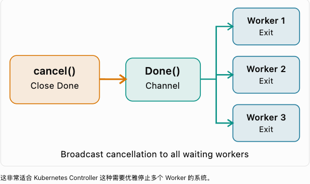  
- **select：同时监听多个 Channel**
	- ```go
	  select {
	  case <-ctx.Done():
		  return
	  case job := <-jobs:
		  process(job)
	  }
	  ```
	- `select` 默认只执行一次
	- 如果多个 Case 同时 Ready，Go 会伪随机选择其中一个
	- 如果没有任何 Case Ready，`select` 会等待
	- 如果有 `default`，且没有 Case Ready，就执行 `default`，不会等待
	- 实际服务中经常使用: select + for(持续监听)
		- ```go
		  //持续处理job，直到 Context 被取消
		  for {
			  select {
			  // 如果 `jobs` 可能关闭，要使用 `job, ok := <-jobs`，避免关闭后反复接收到零值
			  case job := <-jobs:
				  process(job)
			  case <-ctx.Done(): 
				  return
			  }
		  }
		  ```
- **Channel vs Mutex**
	- Channel 和 Mutex 都可以用于 Goroutine 之间的并发协调，但它们的设计目的不同
		- Channel：
			- 核心思想：发送和接收数据来实现通信与同步
			- 目的：用于 Goroutine 之间的数据传递和通信（Communication）
		- Mutex：
			- 核心思想：多个 Goroutine 可以访问同一个变量，但是同一时刻只允许一个 Goroutine 进入受保护的 Critical Section（临界区).
			- 目的：用于保护多个 Goroutine 共享的数据(Mutual Exclusion), 并不负责传递数据
   			- 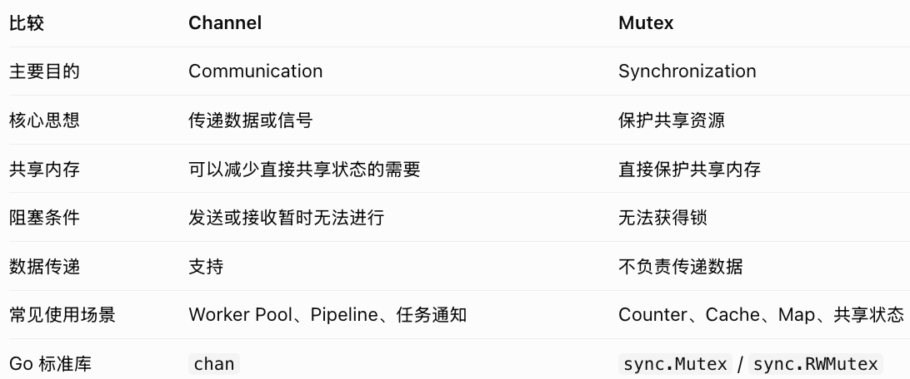  
	- 虽然Go的经典设计理念是`share memory by communicating`, 但这并不意味着 Go 推荐所有场景都使用 Channel。实际上，对于简单的共享状态保护，Mutex 往往更直接、更高效。
		- 多个 Goroutine 需要同时读写一个缓存 --> `sync.RWMutex`
		- Worker Pool 处理jobs --> channel
	- 假设有 100 个 Goroutines,每个都需要将 Counter 加 1，可以分别用Mutex 和 Channel来实现
 		- 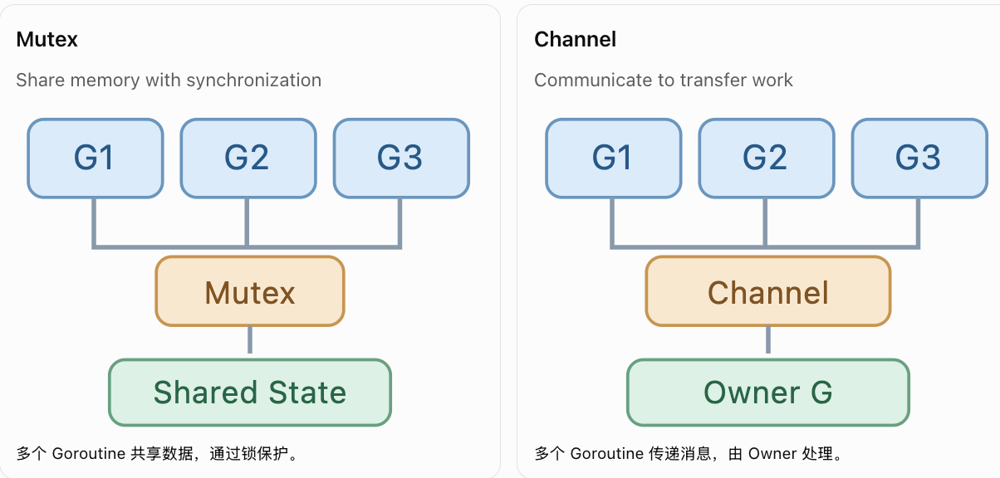  
		- 方案一：Mutex
		- ```go
		  func main(){
			  var counter int
			  var mu sync.Mutex
			  var wg sync.WaitGroup
			  
			  for i:=0; i<100; i++ {
				  wg.Add(1)
				  go func(){
					  mu.Lock()
					  counter++
					  mu.Unlock()
				  }()
			  }
			  wg.Wait()
			  fmt.Println("Counter:", counter) // 100
			  
		  }
		  ```
	- 方案二：Channel
		- 使用 Channel 时，我们需要改变架构，不让 100 个 Goroutine 都直接修改 `counter`，而是让它们发送消息，由一个专门的 Goroutine 负责更新变量。 这种设计常叫做 **Single Owner Pattern（单一所有者模式）**
		- ```go
		  func main(){
			  ch := make(chan int)
			  var wg sync.WaitGroup
			  
			  // Producer goroutines
			  for i:=0; i<100; i++ {
				  wg.Add(1)
				  go func(){
					  defer wg.Done()
					  ch <- 1
				  }()
			  }
			  // Close channel after all senders finish
			  go func() {
				  wg.Wait()
				  close(ch)
			  }()
			  
			  // Main goroutine owns counter
			  counter := 0
			  for value := range ch {
				  counter += value
			  }
			  fmt.Println("Counter:", counter) // 100	  
		  }
		  ```
### Context
- `context.Context` 用于在一组相关操作之间传递信息，比如Cancellation、Deadline 和 Request-scoped Values(请求级数据)
	- 例如，一个 HTTP Request 需要调用 Service、Database 和外部 API。如果客户端取消请求，或者请求超时，我们希望相关的操作也能够尽快停止，而不是继续消耗资源。
- `context.Context` 本身是一个 Interface
	- ```go
	  type Context interface{
		  Deadline() (deafline time.Time, ok bool) // 查询操作应该在哪个时间之前结束
		  Done() <-chan struct{} // 返回一个用于通知取消的 Channel
		  Err() error // 查询 Context 取消的原因
		  Value(key any) any // 获取 Context 携带的请求级数据
	   }
	  ```
- **Context 是如何创建的?**
	- 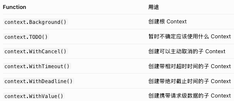 
	- ```go
	  ctx := context.Background() //创建一个根Context
	  // 创建一个新的Context, 要求相关操作最多等待5秒
	  ctx, cancel := context.WithTimeout(ctx, 5*time.Second)
	  defer cancel() // 用于在当前函数结束时释放相关资源
	  ```
- **Context Tree：Parent Context 和 Child Context**
	- Cancellation 从 Parent 向 Child 传播，不会反向传播
	- ```go
	  // 创建parent context
	  parent, cancelParent := context.WithCancel(context.Background())
	  
	  // 创建child contexts
	  child1, cancel1 := context.WithCancel(parent)
	  child2, cancel2 := context.WithTimeout(parent, duration)
	  child3 := context.WithValue(parent, key, value)
	  
	  // 只会取消child1及其后代，不会取消parent, child2和child3
	  cancel1()
	  
	  // parent被取消，child1, child2，child3 都被取消
	  cancelParent() 
	  //另外,如果Parent的Deadline是3秒,而Child设置了10秒超时,Child实际仍然会在Parent的3秒Deadline到期时被取消
	  
	  ```
- **实际 Backend System 中如何使用 Context?**
	- 假设你有一个 HTTP Handler，接收客户端请求后查询数据库
	- Go Context 的 Cancellation 是一种 Cooperative Cancellation（协作式取消），不是强制终止执行。
		- Parent Context 取消后，Child Context 不需要等 Handler 返回就会被取消；
		- 但是 Handler 是否能够快速结束，仍然取决于它正在执行的操作是否响应取消信号
	- ```go
	  func GetUserHandler(w http.ResponseWriter, r *http.Request) {
		  // parent context from HTTP request
		  //当客户端连接关闭、请求取消，或Handler返回时,Request Context会被取消。
		  ctx := r.Context() 

		  // create database timeout context
		  dbCtx, cancel := context.WithTimeout(ctx, 3*time.Second)
		  //它有自己的 3 秒 Timeout，同时继承 Parent Request Context 的取消信号
		  
		  defer cancel() // 当前函数即将返回时执,Go会自动调用cancel()

		  // Execute DB query
		  // 这里db假设是已经初始化的*sql.DB
		  row := db.QueryRowContext(
		      dbCtx,
		      "SELECT name FROM users WHERE id = $1",
		      123,
		  )

		  var name string
		  // Context被取消 ≠ Database Query 停止
		  //具体何时停止、能否终止db query，取决于 Driver和Database
		  //对于支持 Context Cancellation的db driver，正在执行的db query通常会提前返回错误
		  err := row.Scan(&name)

		  if err != nil {
			  http.Error(
		          w,
		          "Query failed",
		          http.StatusInternalServerError,
		      )
		      return
		  }

		  fmt.Fprintln(w, name)
	  }
	  ```
